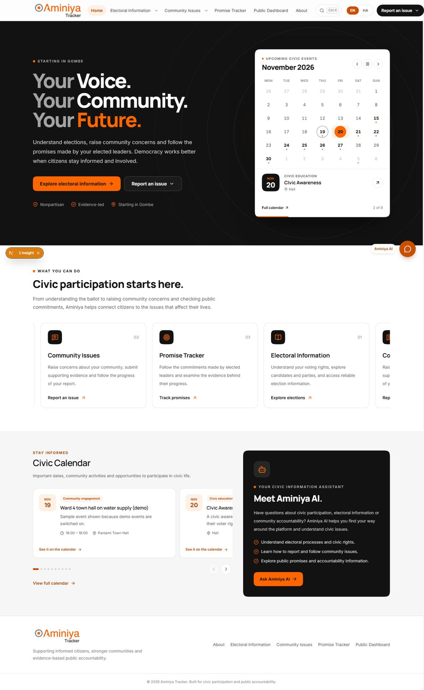
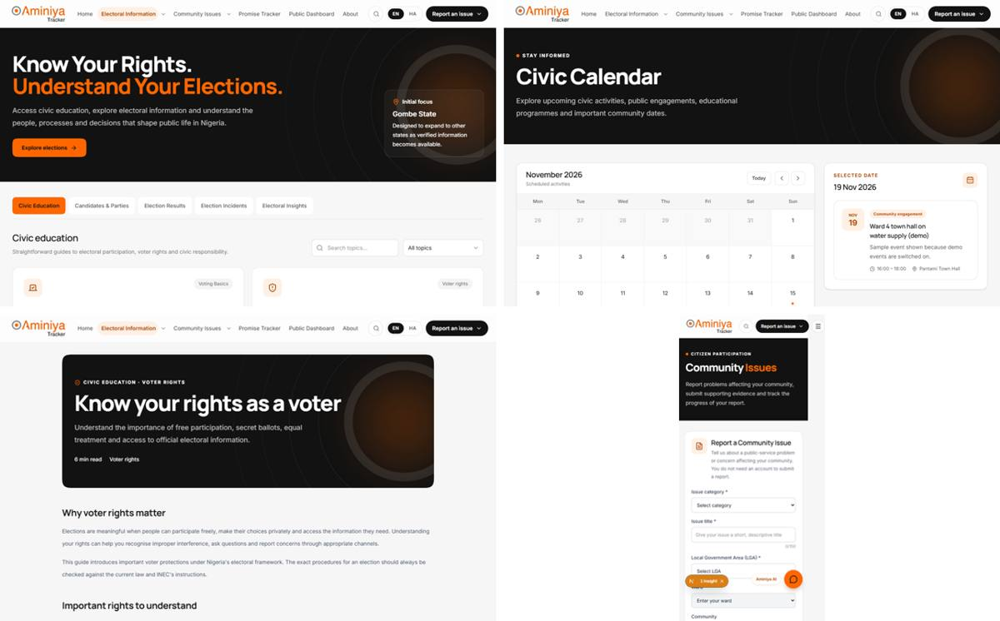
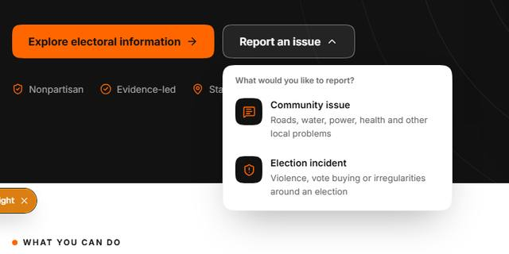
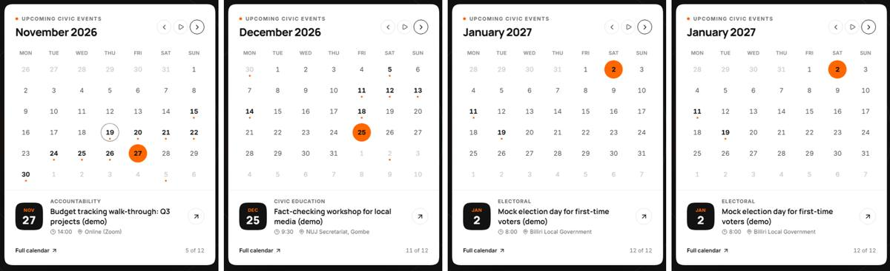
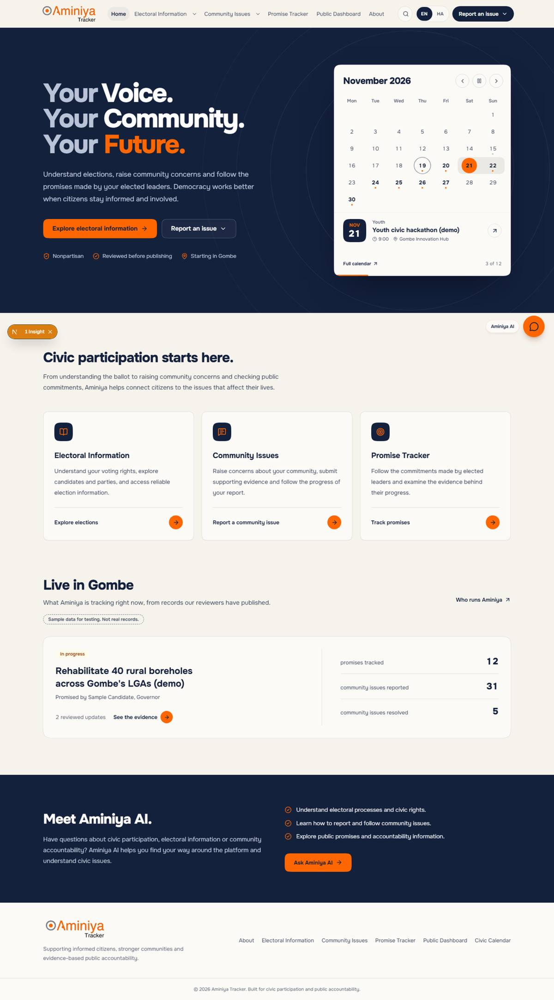

# Design history

Aminiya Tracker has had three visual designs. This page records each one so
any of them can be compared against or brought back.

| # | Design | Where it lives |
|---|--------|----------------|
| 1 | Classic: orange on cream | Branch `backup/home-classic` (commit `9f5a1ea`) |
| 2 | Ink & Signal: black, logo orange, logo grey | Never committed. Recorded below and in the screenshots in this folder |
| 3 | Paper, navy, orange (60/30/10) | Current design |

## 1. Classic

The original site: a cream hero (`#faf9f7`) with the vote illustration,
burnt-orange buttons (`#c94f00`) with white text, Manrope headings over
Inter body text.

To see it, check out the branch:

```bash
git switch backup/home-classic
```

## 2. Ink & Signal

An interim design built from the logo's colours. It was reworked in place
before it was committed, so no commit holds it. To rebuild it, start from
the current design and apply the values below.



Interior pages, with the shared page hero in ink:



The Report dropdown and the hero calendar stepping through months:





### Colour tokens

| Token | Value | Use |
|---|---|---|
| `--ink` | `#121212` | Hero and section grounds, the header Report pill, icon tiles |
| `--ink-raised` | `#262626` | Hover on ink |
| `--signal` | `#ff6600` | Logo orange: primary buttons (with ink text), headline accents, icons |
| `--signal-hover` | `#ff7d29` | Hover on orange buttons |
| `--signal-deep` | `#a84300` | Small orange text on white (6:1) |
| `--signal-soft` | `#fff0e5` | Tints and selected states |
| `--canvas` | `#f6f6f6` | Neutral page background |
| `--logo-grey` | `#808080` | The logo's ring grey |
| `--logo-grey-on-ink` | `#a3a3a3` | Secondary text on ink |

Cards were white, borders were neutral greys, and text was `#171717`.

### Type and structure

- Manrope (headings) and Inter (body). Manrope has no Hausa hooked
  letters (ɓ ɗ ƙ ƴ), so Hausa headings fell back to another font.
- Home hero in ink, with the logo's ring mark enlarged behind the calendar
  and an orange radial glow.
- A small eyebrow label with an orange dot above most headings.
- "What you can do" feature cards (01 / 02 / 03) in an auto-scrolling strip.
- A second, compact calendar carousel next to an ink "Meet Aminiya AI" card.
- Interior pages opened with an ink page hero.

## 3. Paper, navy, orange (current)



| Share | Colour | Use |
|---|---|---|
| 60% | Paper `#F6F3EC` | Pages and cards |
| 30% | Navy `#14213D` | Heroes, primary text, dark controls |
| 10% | Orange `#FF6600` | Primary actions and highlights only |

Secondary text, lines and fills are tints of navy, never neutral greys.
Status colours (red, amber, green) carry meaning and sit outside the ratio.
Tokens are in `src/app/globals.css`. The single font is Onest, which has
every Hausa letter.
